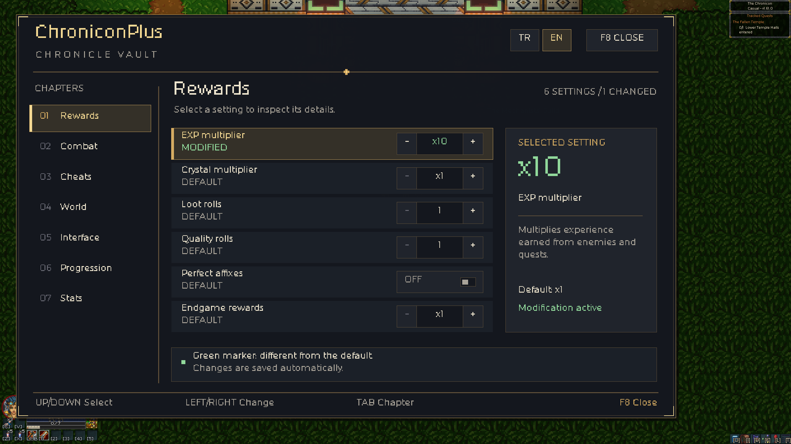
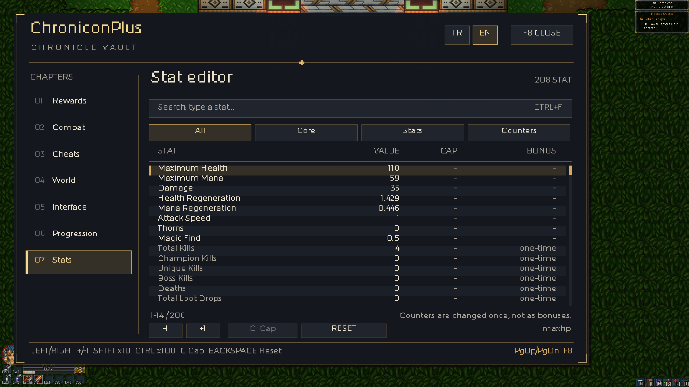

# ChroniconPlus — Chronicle Vault

An in-game mod menu for **Chronicon** (Steam, Windows x64, game version **1.54.1**). Press **F8** in game.

ChroniconPlus is a small native DLL pair. It needs **no** mod loader, framework, .NET or Visual C++ runtime, and it
does not modify `Chronicon.exe` or `data.win`. Single-player game; there is no anti-cheat.



## Install

1. Close the game.
2. In Steam: **Library → Chronicon → right click → Manage → Browse local files**.
3. Download `ChroniconPlus-<version>.zip` from [Releases](../../releases) and extract it **into that folder**:
   ```
   Chronicon\version.dll
   Chronicon\ChroniconPlus\ChroniconPlus.Core.dll
   ```
4. Start the game, load a character, press **F8**.

**Uninstall:** delete `version.dll` (and the `ChroniconPlus` folder to remove settings).
**Disable temporarily:** put an empty file named `disabled` into the `ChroniconPlus` folder.

**Back up your save first:** `%LOCALAPPDATA%\Chronicon`. Unlock actions (dyes, Gambler, waypoints) are permanent.

## Features

| Chapter | Settings |
|---|---|
| Rewards | EXP, crystals, loot rolls, quality rolls (best of N), perfect affixes, endgame rewards |
| Combat | Damage dealt / taken, skill cooldowns, mana cost, game speed |
| Cheats | God mode, infinite mana, no cooldowns, free purchases |
| World | Monster density, champion / elite chance, reveal map, camera distance, no chest traps, pickup radius |
| Interface | Damage meter (DPS), death recap (last 10 hits, shown on the death screen) |
| Progression | Talent point multiplier, unlock all dyes, unlock Gambler, unlock all waypoints |
| Stats | Editor for all 208 character stats: search (Ctrl+F), groups, +/- bonus, cap removal |

The menu is available in Turkish and English (TR / EN at the top right; independent of the game's language).
Settings are saved to `ChroniconPlus\ChroniconPlus.ini` immediately.



## Compatibility

- Tested on the Steam release of Chronicon 1.54.1, Windows 11, at 2560×1440, 1920×1080, 1680×1050 (16:10) and 1280×720.
- On start-up the mod looks up the game's functions by name instead of fixed addresses. If a future game update
  changes them, it installs nothing (the game runs unmodded) and writes the reason to `ChroniconPlus\ChroniconPlus.log`.
- If the game folder is not writable for your Windows user, settings and log go to `%LOCALAPPDATA%\ChroniconPlus`.
- **Steam Deck / Linux (Proton):** not tested. Proton needs the launch option `WINEDLLOVERRIDES="version=n,b" %command%`.
- Some antivirus products flag any unsigned `version.dll` placed next to a game (it is how the mod gets loaded). The full
  source is in this repository; you can build it yourself.

## Troubleshooting

- **F8 does nothing:** make sure `version.dll` sits next to `Chronicon.exe` (not in a subfolder) and check
  `ChroniconPlus\loader.log` and `ChroniconPlus\ChroniconPlus.log`.
- **"runner not recognised" in the log:** your game version is not supported yet; open an issue with the log.

## Building

Requires Visual Studio 2022 or later with the **Desktop development with C++** workload.

```
cd src\ChroniconNative
build.bat
build\hook_test.exe
```

Output: `build\version.dll` (loader) and `build\ChroniconPlus.Core.dll` (core).

| Path | What |
|---|---|
| `src/ChroniconNative/proxy` | `version.dll` proxy: forwards the system `version.dll` and starts the core |
| `src/ChroniconNative/core/runner.*` | Finds the GameMaker YYC runner at runtime (function table, builtins, runner interface) |
| `src/ChroniconNative/core/hook.*`, `x64_decode.*` | x64 inline hook engine |
| `src/ChroniconNative/core/Menu.cpp` | The F8 menu, drawn with the game's own GUI functions |
| `src/ChroniconNative/core/Features.cpp`, `Stats.cpp` | Gameplay features and the stat editor |
| `tools/cp.py` | Sends commands to a running game (`ChroniconPlus\ipc`), used for automated tests |
| `tools/check_vault_ui.py` | Automated menu test suite (80 checks), run against a live game |

The test tools expect this repository to be cloned as `<game folder>\_ModKit`.

Fan-made and not affiliated with the developers of Chronicon. Use at your own risk.
